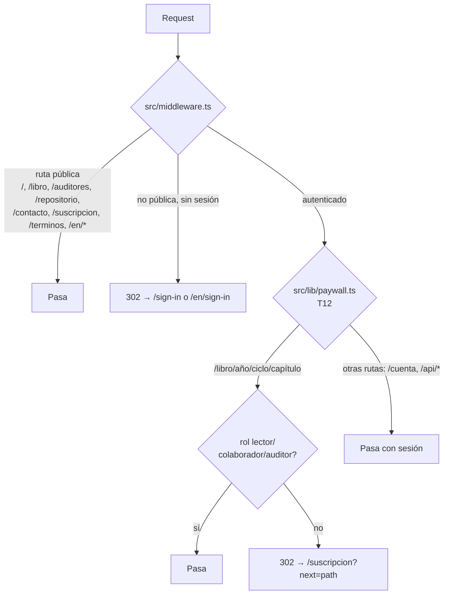
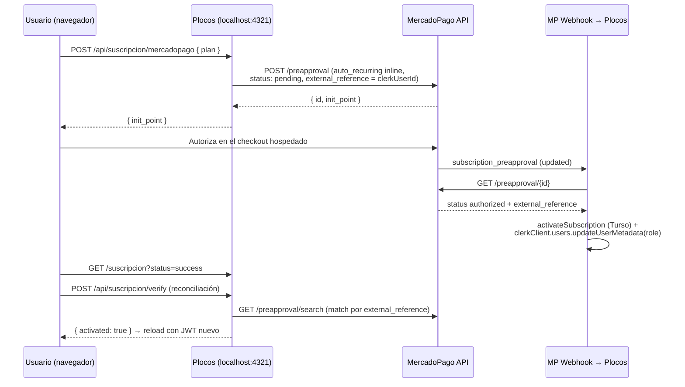

# Arquitectura de PLOCOS — Plataforma Nomás que la Vida (NQLV)

> Documento vivo: describe la arquitectura actual del proyecto tras el pivote
> de blog-archivo a plataforma de suscripciones para el libro interactivo
> **Nomás que la Vida** (doc maestro del cliente en `requerimientos-cliente.md`).

## Stack

| Capa | Tecnología | Versión |
|---|---|---|
| Framework | Astro (output: `server`) | 7.3.1 |
| Adapter | `@astrojs/netlify` | 8.2.5 |
| Auth | Clerk (`@clerk/astro`) | 4.1.9 |
| DB | libSQL (Turso) + Drizzle ORM | @libsql/client 0.7 |
| Pagos | MercadoPago SDK (`mercadopago`) + Suscripciones (preapproval) | 3.6.1 |
| Estilos | Tailwind CSS 4 + Flowbite | 4.3.3 + 4.0.2 |
| i18n | Astro nativo (es default, en mirror) | builtin |
| Env vars | `.env.local` → `import.meta.env` | Vite |
| Tests | Vitest (`tests/**/*.test.ts`) | 5.0.3 |

## Modelo de roles y acceso

Tres roles globales (doc maestro §Roles). El rol vive en Clerk
`publicMetadata.role` y viaja en el JWT de sesión como `metadata.role`
(Clerk Dashboard → Sessions → Customize session token:
`{"metadata": "{{user.public_metadata}}"}`).

| Rol | Cómo se obtiene | Derechos |
|---|---|---|
| `lector` | Suscripción al plan Lector | Lectura del canon + Repositorio (solo lectura) |
| `colaborador` | Suscripción al plan Colaborador | Todo lo anterior + enviar aportes (firma Habeas Scriptum) |
| `auditor` | Ascenso: 4+ aportes Nivel 3 lifetime (T22) | Todo lo anterior + rango honorífico |

Sin rol (`null`): solo contenido público. Lógica en `src/lib/access.ts`,
tests en `tests/t26-access.test.ts`.

## Capas de acceso (dos puertas)



- **Puerta 1 (auth, T08):** `src/middleware.ts` — la lista pública está en
  `isPublicRoute`. El webhook `/api/webhooks/mercadopago.ts` también redirige
  pero Clerk es la fuente de sesión.
- **Puerta 2 (paywall, T12):** `src/lib/paywall.ts` — patrón
  `/libro/<year>/<cycle>/<chapter>` exige rol pago. Los índices de año y ciclo
  quedan públicos para que el visitante explore el archivo antes de pagar.

## Flujo de suscripción (MercadoPago, T11)



**Doble vía de activación (lección de producción):** el webhook es el camino
primario, pero la reconciliación en el retorno cubre su falta (túnel muerto,
reintentos agotados). Ambos caminos son idempotentes:
`activateSubscription` hace upsert por `(provider, providerSubscriptionId)`.

### Modelo elegido: suscripciones SIN plan asociado

Los planes creados desde el panel de MP quedan atados a débito automático:
crear un preapproval asociado a ellos exige `card_token_id` (tokenización de
tarjeta en el cliente). El modelo sin plan (`auto_recurring` inline +
`status: "pending"`) devuelve `init_point` sin tokenización y conserva
`external_reference` — el único binding que asocia la suscripción con el
usuario. Ver `docs/diagramas/dev/suscripcion-mercadopago.md` para el catálogo
completo de gotchas.

### Política de respuestas del webhook

| Escenario | Respuesta | Por qué |
|---|---|---|
| Prueba simulada del panel (sin firma) | 200, no procesa | Un payload sin firmar jamás toca la DB |
| Firma inválida | 400 | Evento real manipulado |
| Preapproval inexistente (MP 404) | 200 + warn | Permanente: reintentar no arregla nada y los 500 sostenidos hacen que MP **desactive el webhook** |
| Preapproval `authorized` | 200 | Activa suscripción + rol |
| `pending`/`paused`/`cancelled` | 200 | Sin cambio de rol (aún) |
| Error transitorio (red, MP 5xx, DB) | 500 | MP reintenta con backoff |

### Verificación de firma

`verifyMPSignature` (T11): HMAC-SHA256 con la **clave secreta del panel**.
Manifest con **dos puntos** (artículo de soporte MP 51017):
`id:<dataId>;request-id:<xRequestId>;ts:<ts>;`. Ventana anti-replay de 5
minutos. Comparación en tiempo constante.

## Ascenso a Auditor (T22)

`src/lib/auditor.ts` — lógica pura, la consume el cron (T23, pendiente):

- `ASCENTION_THRESHOLD = 4`: aportes que alteraron el canon (Nivel 3) en
  toda la vida → promoción de `colaborador` a `auditor`.
- `RENEWAL_THRESHOLD = 2`: aportes por año calendario para mantener el rango.

## Estructura del proyecto (núcleo NQLV)

```mermaid
graph TD
    Src[src/] --> Pages[pages/]
    Src --> Lib[lib/]
    Src --> Comp[components/]
    Src --> MW[middleware.ts]

    Pages --> Pub[/libro, /auditores, /repositorio,<br/>/contacto, /suscripcion + mirrors /en/*]
    Pages --> Legal[/terminos/*, /privacidad,<br/>/politica-de-cookies]
    Pages --> AuthUI[/sign-in, /sign-up, /cuenta]
    Pages --> API[api/]
    API --> MPWebhook[api/webhooks/mercadopago.ts]
    API --> ClerkWebhook[api/webhooks/clerk.ts]
    API --> Books[api/books/year/cycle.pdf<br/>T14a: PDF bajo rol]
    API --> Checkout[api/suscripcion/mercadopago.ts]
    API --> Verify[api/suscripcion/verify.ts]

    Lib --> Access[lib/access.ts<br/>roles desde claims]
    Lib --> Paywall[lib/paywall.ts]
    Lib --> MP[lib/mercadopago.ts]
    Lib --> Auditor[lib/auditor.ts]
    Lib --> DB[lib/db/<br/>schema, users, subscriptions, books]
    Lib --> Routes[lib/routes.ts, lib/i18n.ts,<br/>lib/routeMatcher.ts]

    Tests[tests/*.test.ts<br/>Vitest — 307 tests]
```

## Variables de entorno

> **Regla crítica (seguirá siendo cierta en cualquier Vite):** las vars de
> `.env.local` están en `import.meta.env`, **no** en `process.env`. Única
> excepción tolerada: fallback en `src/lib/mercadopago.ts` para contextos
> Node puros.

```bash
# Clerk
PUBLIC_CLERK_PUBLISHABLE_KEY=pk_test_...
CLERK_SECRET_KEY=sk_test_...
CLERK_WEBHOOK_SIGNING_SECRET=whsec_...

# MercadoPago (credenciales de TEST para desarrollo)
MERCADOPAGO_PUBLIC_KEY=APP_USR-...
MERCADOPAGO_ACCESS_TOKEN=APP_USR-...
MERCADOPAGO_WEBHOOK_SECRET=<Clave secreta del panel de webhooks>
MERCADOPAGO_PRICE_LECTOR=9900        # COP/mes, mínimo 1600
MERCADOPAGO_PRICE_COLABORADOR=20000  # COP/mes

# Turso
ASTRO_DB_REMOTE_URL=libsql://...
ASTRO_DB_APP_TOKEN=...
```

Lista canónica y completa en `.env.example`.

## Pipeline de build y deploy

```bash
pnpm verify:pacto   # prebuild hook: SHA-256 del texto literal del pacto
pnpm build --remote # astro build --remote (Netlify)
pnpm test           # vitest run — 307 tests
```

## Decisiones arquitectónicas vigentes

| Decisión | Razón | Commit |
|---|---|---|
| Clerk con `publicMetadata.role` (NO Organizations) | Roles globales de 3 niveles; Organizations es multi-tenant | T26 |
| Rol en el JWT de sesión | Header y redirects sin query a DB por request | T26 |
| Paywall separado del gate de auth (T12) | El auth gate decide sesión; el paywall decide tier | `f93cdff` |
| Suscripciones MP sin plan asociado | Los planes del panel exigen `card_token_id`; sin plan devuelve `init_point` | `6870bec` |
| Reconciliación además del webhook | El webhook solo no sobrevive a túneles muertos ni reintentos agotados | `e17539d` |
| Webhook: 404 de MP → 200 | Los 500 sostenidos hacen que MP desactive el webhook | `aa82f5c` |
| Manifest HMAC con dos puntos | Especificación oficial MP (artículo 51017) | `a9236af` |
| `!text-surface-base` en CTAs `<a>` | La regla global `a{color:var(--accent)}` pisaba el color; fix puntual pendiente de refactor a scoping `.prose a` | `3de6fd8` |
| Flowbite v4 patterns en botones/nav | Consistencia de hovers en light/dark tras iteración con el cliente | `65ffabf` |
| `import.meta.env` para `.env.local` | Vite no popula `process.env` | pre-pivote |
| Verifier SHA-256 byte-level del pacto | El texto literal del cliente no muta | `27aee9f` |

## Estado de tareas (feature doc `odd/tasks/plataforma-nomas-que-la-vida.md`)

- **Hechas:** T01, T03-T08, T11, T12, T13-T17, T14a, T22, T25, T26, T27.
- **Pendientes:** T02 (verificar robots-anti-ia), T10 (PayPal — extranjeros),
  T14 (capítulos completos), T18 (i18n extension), T19 (triaje Gemini),
  T20 (aprobación por correo), T21 (Habeas Scriptum clickwrap),
  T23 (cron ciclo 60 días), T24 (Netlify storage PDFs).

## Ver también

- `docs/guia-desarrollo-local.md` — cómo levantar todo en local (Clerk + MP + túnel)
- `docs/diagramas/dev/suscripcion-mercadopago.md` — diagrama de secuencia completo + catálogo de gotchas de la integración
- `docs/diagramas/dev/` — diagramas técnicos
- `odd/tasks/plataforma-nomas-que-la-vida.md` — feature document con el estado tarea por tarea
- `requerimientos-cliente.md` — doc maestro del cliente (fuente de verdad del producto)

---

Última actualización: 2026-10-17
Rama: `feature/pr-2-auth-legal`
