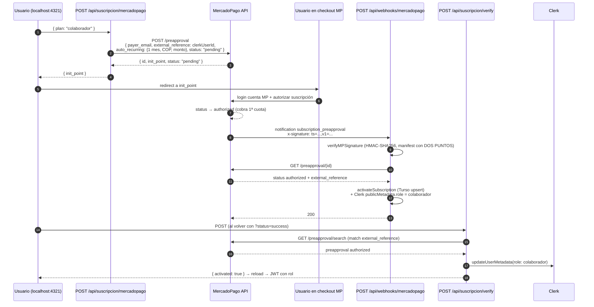

# Suscripción MercadoPago — Flujo completo y catálogo de gotchas (T11)

> Diagrama de secuencia del flujo implementado y el registro de cada problema
> encontrado durante la integración en vivo (2026-10-17), con su causa raíz y
> fix. Documento de referencia para debugging y para no repetir los errores.

## Diagrama de secuencia completo



## Los dos caminos de activación

| Camino | Cuándo sirve | Cobertura |
|---|---|---|
| **Webhook** (`/api/webhooks/mercadopago`) | MP entrega la notificación | Primario; imprescindible para cancelaciones/pausas futuras |
| **Reconciliación** (`/api/suscripcion/verify`) | El usuario vuelve con `?status=success` | Cubre webhook perdido: túnel muerto, dev server apagado en los reintentos, reintentos agotados |

Ambos son idempotentes: `activateSubscription` (Turso) hace upsert por
`(provider, providerSubscriptionId)` y luego sube el rol en Clerk.

## Catálogo de gotchas (en orden de aparición)

### 1. El texto del CTA era invisible (dark mode)

**Síntoma:** botón "Suscríbete" = píldora sólida sin texto.
**Causa raíz:** regla global `a { color: var(--accent); }` en
`src/styles/tailwind.css` pisaba `text-surface-base` en los CTAs que son
`<a>`. El botón "Enviar" del formulario (un `<button>`) nunca fue afectado —
por eso "funcionaba" ahí y no en el header.
**Fix:** `!text-surface-base` (important-prefix de Tailwind 4) en todos los
CTAs `<a>`. **Pendiente de refactor limpio:** scoping de la regla global a
`.prose a` para eliminar el `!important`.

### 2. Los hovers "no funcionaban"

**Síntoma:** el cliente insistía en que los hovers estaban mal en light y dark.
**Causa raíz doble:** (a) clases inexistentes en el config de Tailwind
(`text-heading`, `hover:bg-neutral-tertiary`) que no generan CSS y fallan en
silencio; (b) hand-rolled patterns inconsistentes.
**Fix:** migración a patrones Flowbite v4 (primary/outline/icon buttons,
`hover:bg-accent/10 hover:text-accent`). Lección: **verificar que cada clase
exista en el config** — Tailwind ignora clases desconocidas sin error.

### 3. Manifest del webhook: dos puntos, no signos igual

**Síntoma:** todo webhook firmado → `400 hmac_mismatch`.
**Causa raíz:** el manifest se armaba con `id=...;request-id=...;ts=...;`.
La especificación oficial (artículo de soporte MP 51017) usa **dos puntos**:
`id:...;request-id:...;ts:...;`.
**Fix:** `a9236af`. Diagnóstico local documentado por MP:
`echo -n "id:$id;request-id:$rid;ts:$ts;" | openssl dgst -sha256 -hmac 'secret'`

### 4. `MERCADOPAGO_ACCESS_TOKEN is not set`

**Causa raíz:** `fetchPreapproval` leía `process.env`; Astro expone
`.env.local` vía `import.meta.env`.
**Fix:** `import.meta.env.X ?? process.env.X` (fallback para contextos Node).
Mismo patrón que el webhook de Clerk.

### 5. `clerkClient()` sin contexto

**Síntoma:** `TypeError: Cannot use 'in' operator to search for 'locals' in
undefined` en cada POST.
**Causa raíz:** `clerkClient()` de `@clerk/astro` exige el contexto de Astro
como argumento.
**Fix:** `clerkClient(context)` en ambos call sites (checkout + webhook).

### 6. `card_token_id is required`

**Síntoma:** `POST /preapproval` con `preapproval_plan_id` → 400
`card_token_id is required`, con y sin `status` en el body.
**Causa raíz:** los planes creados desde el **panel** de MP quedan atados a
débito automático; crear el preapproval por API contra ellos exige haber
tokenizado la tarjeta en el cliente.
**Fix (pivote de modelo):** suscripciones **sin plan asociado** —
`auto_recurring` inline (frecuencia, monto, moneda) + `status: "pending"` →
MP devuelve `init_point` para autorización hospedada, sin tokenización en
nuestro código, y conserva `external_reference`.
**Gotcha adicional:** monto mínimo COP $1.600 (`Cannot pay an amount lower
than $ 1600.00`).

### 7. El webhook no llegó (y no llegará a veces)

**Síntoma:** pago autorizado en vivo, cero logs `[mp webhook]`.
**Causa raíz:** el quick tunnel se reinició una hora después del pago y los
reintentos de MP (cada ~15-25 min) golpearon un dev server apagado hasta
agotarlos. Los errores `Unable to reach the origin service` en el log de
cloudflared **eran los reintentos de MP**.
**Fix:** reconciliación en el retorno (`verify`) — el rol ya no depende de la
entrega del webhook. Además: 404 de MP → 200 (los 500 sostenidos hacen que MP
desactive el webhook).

### 8. Reconciliación: no buscar por email

**Síntoma:** suscripción autorizada con `external_reference` correcto, pero
`verify` devolvía `activated: false`.
**Causa raíz:** la búsqueda filtraba por `payer_email` (el email de la cuenta
Clerk). Si el email del Clerk ≠ la cuenta MP que pagó, no matchea.
**Fix:** `GET /preapproval/search` **sin filtro de email** + match solo por
`external_reference === clerkUserId && status === 'authorized'`. Verificado
en vivo: la búsqueda sin filtro devuelve las suscripciones de la app.

### 9. Clerk dev: 403 en POST autenticado vía túnel

**Síntoma:** `POST /api/suscripcion/verify → 403 en 0ms` con sesión activa.
**Causa raíz:** la instancia dev de Clerk rechaza requests autenticados desde
orígenes fuera de su allowlist (solo `localhost` por defecto). El dominio del
quick tunnel no está allowlistado y cambia en cada reinicio.
**Fix operativos:** (a) **navegar siempre por `localhost:4321`** — el túnel es
solo para webhooks entrantes; (b) en producción el dominio propio se registra
en Clerk (Developers → Domains) y el problema no existe.

### 10. Clerk dev: verificación de email y Device Trust

**Síntoma:** imposible crear/loguear cuentas con emails de prueba
(`@testuser.com` no recibe código).
**Fix:** en la instancia de desarrollo: *Verify at sign-up* **OFF** y
*Device Trust* **OFF** (el segundo pide código "desde un nuevo device" en
cada login). En producción ambos vuelven a ON.

## Checklist de configuración de webhooks (MP panel)

1. Pestaña **Modo de prueba** (misma secret que `MERCADOPAGO_WEBHOOK_SECRET`)
2. URL: `https://<túnel>/api/webhooks/mercadopago`
3. Evento: **Planes y suscripciones**
4. Botón "Enviar prueba" → debe responder **200 OK** (el payload simulado
   `id: "123456"` no existe → el handler lo reconoce y responde 200 sin
   procesar; ver consola: `acknowledged without processing`)
5. Actualizar la URL **cada vez que se reinicie cloudflared**

## Comandos de diagnóstico rápido

```powershell
# Estado de las suscripciones de un pagador (busca la authorized)
curl.exe -s -H "Authorization: Bearer $env:MERCADOPAGO_ACCESS_TOKEN" `
  "https://api.mercadopago.com/preapproval/search?limit=50"

# Crear usuario de prueba (devuelve email + password)
curl.exe -s -X POST -H "Authorization: Bearer $env:MERCADOPAGO_ACCESS_TOKEN" `
  -H "Content-Type: application/json" `
  -d '{\"site_id\":\"MCO\"}' https://api.mercadopago.com/users/test_user

# Verificar el HMAC de una notificación (formato oficial MP)
echo -n "id:$payment_id;request-id:$request_id;ts:$ts;" | `
  openssl dgst -sha256 -hmac 'secret_panel_webhooks'
```

## Lo que queda pendiente en pagos

- **T10 PayPal** (extranjeros) — mismo patrón: creación → webhook firmado →
  reconciliación.
- **Downgrades/cancelaciones:** hoy el webhook ignora `cancelled`. Falta la
  política (downgrade inmediato vs fin de periodo).
- **Refactor `!important`:** scoping de `a{color:var(--accent)}` a `.prose a`.
- **Cron T23:** lectura de aportes Nivel 3 + `evaluateAscention` → rol
  `auditor` automático.
